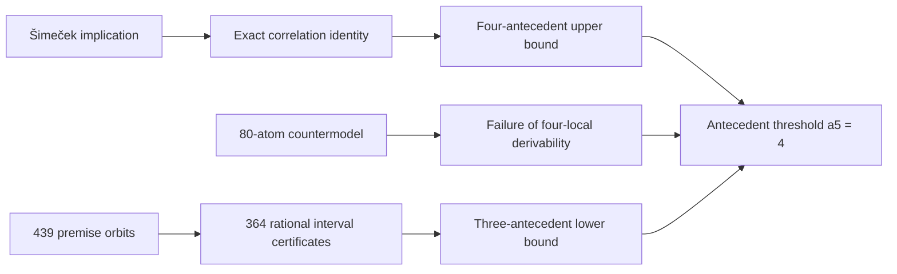

# Gaussian CI Antecedent Threshold

[](https://github.com/Maar10Herr/Gaussian-CI-a5-Equals-4-Public/actions/workflows/ci.yml)
[](LICENSE)
[](https://orcid.org/0009-0005-8721-6588)

Exact verification of the sharp antecedent threshold for genuinely
five-variable regular-Gaussian conditional-independence inference.

> [!NOTE]
> **Computer-assisted theorem with independently replayable exact
> certificates.** The result concerns elementary, singleton-conclusion Horn
> implications for regular positive-definite Gaussians. Classification of all
> four-antecedent implications and all five-variable Gaussian CI structures is
> outside its scope.

**[Read the paper](paper/Herrmann_Antecedent_Threshold_Gaussian_CI.pdf)** ·
**[Inspect the certificates](certificates/)** ·
**[Download the latest release](https://github.com/Maar10Herr/Gaussian-CI-a5-Equals-4-Public/releases/latest)**

## Result

Let `T4` be the theory obtained by requiring every marginal and conditional
four-variable face to be one of the 629 regular-Gaussian four-variable CI
structures. Define `a5` as the least number of distinct antecedents in a
premise-minimal, regular-Gaussian-valid Horn implication with full five-label
support that is not a semantic consequence of `T4`. The paper proves

```math
\boxed{a_5=4}.
```

The upper bound uses the five-variable member of Šimeček's implication family,

```math
[12\mid3]\wedge[13\mid4]\wedge[14\mid5]\wedge[15\mid2]
\Longrightarrow [12],
```

and an explicit 80-atom `T4` countermodel. The lower bound classifies every
three-antecedent premise set under label permutations and duality and supplies
exact rational Gaussian counterexamples for every conclusion outside the
four-local closure.

## Verify the theorem

The complete mathematical verification uses only the Python standard library:

```sh
make verify-core
```

The command reconstructs all 679 labelled four-gaussoids directly from the
axioms, selects the 629 regular-Gaussian structures using the five
Lněnička-Matúš schemes, checks the upper-bound identity and countermodel,
replays all 364 rational Krawczyk certificates, proves conclusion coverage,
and runs deliberate-corruption and manifest checks.

Expected principal output:

```text
independent_T4_ok G4=679 T4=629 excluded=50
m3_classification_ok premise_orbits=439 canonical_full_support=335 mixed_support_orbits=105 rule_orbits=21357 nonlocal=21167 certificates=364 second_branches=29 T4=629 cycle_deletions=4
cycle_rule_ok identity=exact gaussoid_axioms=ok t4_faces=10 premise=[1,10,20,25] conclusion=0
corruption_checks_ok cases=4
manifest_ok entries=<release-specific count>
```

For the development tests and package build:

```sh
uv sync --frozen --all-extras
uv run pytest -q
uv build
```

## Proof architecture



| Component | Exact object | Acceptance condition |
|---|---|---|
| Upper-bound validity | Sparse integer-polynomial identity | Telescoping identity agrees coefficient by coefficient |
| Four-local nonlocality | 80-bit CI structure | Premises present, conclusion absent, all axioms and ten faces valid |
| Catalogue | Deterministic CNF enumeration | `679` gaussoids, `629` retained, historical SHA-256 values reproduced |
| Lower bound | 364 rational Krawczyk records | Strict inclusion, positive-definite interval matrix, nonzero conclusion minors |
| Exhaustiveness | 439 premise orbits and complete coverage sets | Every conclusion is four-locally forced or has a certified Gaussian counterexample |
| Integrity | `MANIFEST.sha256` and hostile mutations | Altered proof objects are rejected |

## Self-contained catalogue reconstruction

The release reconstructs the four-gaussoid catalogue from the elementary
gaussoid axioms with a deterministic standard-library DPLL enumerator. The
generated 679-row catalogue and its 629-row regular-Gaussian subset reproduce
the published byte-level SHA-256 values.

This design keeps the release independent of an undocumented third-party data
licence while strengthening reproducibility: researchers can inspect the
axioms, enumeration, higher-rule filter, and pinned digests in
[`independent/catalogue.py`](independent/catalogue.py).

## Numerical and logical evidence

| Quantity | Verified value |
|---|---:|
| Elementary five-label CI atoms | 80 |
| Three-antecedent sets | 82,160 |
| Premise orbits under `S5 × duality` | 439 |
| Full-support canonical representatives | 335 |
| Rule orbits in the certified stratum | 21,357 |
| Nonlocal rule orbits requiring witnesses | 21,167 |
| Rational interval certificates | 364 |
| Representatives requiring a second branch | 29 |

Each certificate fixes seven rational correlations, encloses three remaining
coordinates in rational boxes, and supplies a nonsingular rational Krawczyk
preconditioner. The verifier recomputes determinant and derivative intervals,
strict interior inclusion, Sylvester positivity, and conclusion
nonvanishing. Numerical discovery output is absent from the acceptance path.

## Python research library

The package contains the atom language, exact determinant operations, gaussoid
axioms, symmetry reduction, four-local closure, and interval-certificate
utilities used during the research:

```sh
python3 -m venv .venv
. .venv/bin/activate
python3 -m pip install -e .
```

```python
from five_gaussian_ci.atoms import atoms
from five_gaussian_ci.orbits import symmetry_maps

print(len(atoms(range(1, 6))))          # 80
print(len(symmetry_maps(range(1, 6))))  # 240
```

The independent theorem verifier remains separate from the package and its
SymPy/Z3 development dependencies.

## Intellectual lineage

Šimeček supplied the general shared-endpoint implication family used for the
upper bound. Lněnička and Matúš classified the four-variable case. Boege proved
two-antecedental completeness of the gaussoid axioms and introduced
selfadhesivity; Matúš and Sullivant provide central algebraic and global
incompleteness results. Krawczyk and Rump supply the interval-verification
framework.

Key references:

- Šimeček, *Classes of Gaussian, Discrete and Binary Representable
  Independence Models Have No Finite Characterization* (2006), cited in full
  in the paper.
- Lněnička & Matúš, *Kybernetika* 43 (2007),
  [DML-CZ record](https://dml.cz/handle/10338.dmlcz/135777)
- Boege, *Annals of Mathematics and Artificial Intelligence* 90 (2022),
  [doi:10.1007/s10472-021-09780-0](https://doi.org/10.1007/s10472-021-09780-0)
- Sullivant, *Journal of Pure and Applied Algebra* 213 (2009),
  [doi:10.1016/j.jpaa.2008.11.026](https://doi.org/10.1016/j.jpaa.2008.11.026)
- Rump, *Acta Numerica* 19 (2010),
  [doi:10.1017/S096249291000005X](https://doi.org/10.1017/S096249291000005X)

The contribution of this project is the sharp five-variable threshold relative
to complete four-local inference, together with the countermodel, exhaustive
lower-bound computation, and exact replayable certificates.

## Repository map

```text
paper/          version-0.3 preprint
src/            Python research library
independent/    standard-library catalogue and theorem verifiers
certificates/   accepted exact proof objects
tests/          development and property-based tests
tools/          baseline, catalogue, and integrity utilities
```

## Citation

Use the preferred paper citation in [`CITATION.cff`](CITATION.cff) and cite the
specific release used. Author:
[Maarten Linus Herrmann](https://orcid.org/0009-0005-8721-6588), ORCID
[`0009-0005-8721-6588`](https://orcid.org/0009-0005-8721-6588).

## License

The original software is licensed under
[GPL-3.0-or-later](LICENSE). The reciprocal licence keeps distributed changes
to the implementation and verifier available under the same terms. The paper
is copyright © 2026 Maarten Linus Herrmann; all rights reserved. Cited works,
mathematical results, and upstream project names remain subject to their
respective terms; see [`THIRD_PARTY_NOTICES.md`](THIRD_PARTY_NOTICES.md).
